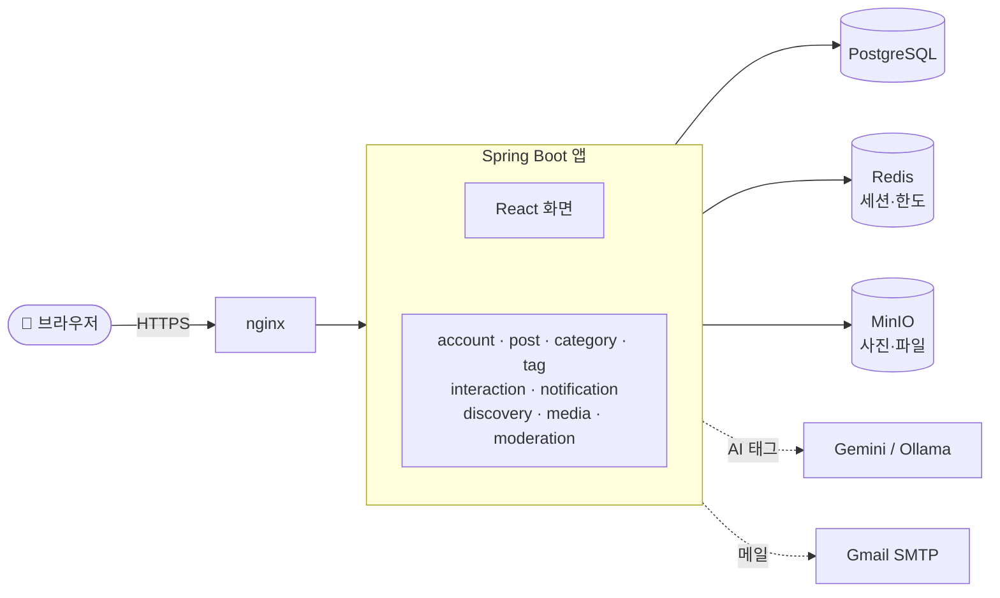
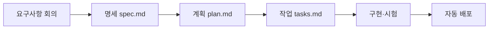

<picture>
  <source media="(prefers-color-scheme: dark)" srcset="https://raw.githubusercontent.com/AIGJ006/BaseLOG/main/frontend/src/assets/logo-b-dark.png" />
  
</picture>

# BaseLOG

### 생각을 기록하고 나누는 블로그 | 글쓰기부터 소통까지

설치 없이 브라우저에서 바로 쓰는 개인 블로그 서비스예요. 
Markdown으로 쓰고, 카테고리로 정리하고, 댓글·좋아요·팔로우로 이웃과 나눠요.

[🌐 사이트 가기](https://baselog.java21.net) · [💻 코드](https://github.com/AIGJ006/BaseLOG) · [📚 설계 문서](https://github.com/AIGJ006/BaseLOG_DOCS) · [📝 기능 명세](https://github.com/AIGJ006/BaseLOG_DOCS/tree/main/specs) · [🗒️ 변경 기록](https://github.com/AIGJ006/BaseLOG/blob/main/CHANGELOG.md)

  <picture>
    <source media="(prefers-color-scheme: dark)" srcset="https://raw.githubusercontent.com/AIGJ006/BaseLOG_DOCS/main/assets/org-profile/home-dark.png" />
    
  </picture>

## 목차

- [왜 BaseLOG인가](#-왜-baselog인가)
- [화면 둘러보기](#-화면-둘러보기)
- [주요 기능](#-주요-기능)
- [아키텍처](#-아키텍처)
- [저장소](#-저장소)
- [기술 스택](#-기술-스택)
- [이렇게 만들었어요](#-이렇게-만들었어요)
- [팀](#-팀)

## 💡 왜 BaseLOG인가

| | 흔한 블로그 | BaseLOG |
| --- | --- | --- |
| ✍️ 글쓰기 | 글자만 입력 | **Markdown + 도구 모음**. 왼쪽에 쓰면 오른쪽에 바로 미리보기, 사진·파일 첨부, 썸네일 고르기 |
| 💾 쓰던 글 | 창을 닫으면 사라짐 | **임시저장**과 브라우저 백업. 다시 열면 이어서 써요 |
| 🗂️ 정리 | 글 목록 하나 | **내 카테고리**(상·하위)와 태그. 사이드바에서 카테고리별로 모아 봐요 |
| 🏷️ 태그 | 직접 입력 | **AI 태그 추천**. Google Gemini가 막히면 자체 AI(Ollama)로 넘어가요 |
| 🔍 발견 | 최신 글만 | **트렌딩 글·요즘 인기 태그**, 글·사람 검색 |
| 💬 소통 | 댓글 | 댓글·답글, 좋아요, **팔로우와 피드**, 🔔 알림 |
| 🌙 보기 | 밝은 화면만 | **다크 모드**(시스템·라이트·다크), PC·휴대폰 화면 |
| 🛡️ 운영 | — | **신고·숨김·정지**, 공지·업데이트 소식 |

## 📸 화면 둘러보기

<table>
<tr>
<td width="50%"><picture><source media="(prefers-color-scheme: dark)" srcset="https://raw.githubusercontent.com/AIGJ006/BaseLOG_DOCS/main/assets/org-profile/editor-dark.png" /></picture> <b>글쓰기</b> — 도구 모음, 실시간 미리보기, 임시저장, 카테고리 선택</td>
<td width="50%"><picture><source media="(prefers-color-scheme: dark)" srcset="https://raw.githubusercontent.com/AIGJ006/BaseLOG_DOCS/main/assets/org-profile/post-dark.png" /></picture> <b>글 읽기</b> — 대표 사진, 코드 강조, 좋아요·댓글</td>
</tr>
<tr>
<td width="50%"><picture><source media="(prefers-color-scheme: dark)" srcset="https://raw.githubusercontent.com/AIGJ006/BaseLOG_DOCS/main/assets/org-profile/blog-dark.png" /></picture> <b>개인 블로그</b> — 카테고리 사이드바, 블로그 안 검색, 태그별 글 수</td>
<td width="50%"><picture><source media="(prefers-color-scheme: dark)" srcset="https://raw.githubusercontent.com/AIGJ006/BaseLOG_DOCS/main/assets/org-profile/notif-dark.png" /></picture> <b>알림</b> — 댓글·좋아요·팔로우를 바로, 종류별로 끄기</td>
</tr>
<tr>
<td width="50%"><picture><source media="(prefers-color-scheme: dark)" srcset="https://raw.githubusercontent.com/AIGJ006/BaseLOG_DOCS/main/assets/org-profile/search-dark.png" /></picture> <b>검색</b> — 글·사람 탭, 관련도순·최신순</td>
<td width="50%"> <b>다크 모드</b> — 설정에서 시스템·라이트·다크 중 고르기</td>
</tr>
</table>

GitHub를 다크 모드로 보면 캡처도 다크 화면으로 바뀌어요.

## ✨ 주요 기능

### ✍️ 쓰기
- **Markdown 에디터** — 네이버 블로그처럼 사진·인용구·구분선·링크·코드·표 단추를 누르면 문법이 들어가요.
- **[임시저장] · [글 등록]** — 임시글은 "임시" 탭에, 등록한 글은 "등록" 탭에 모여요.
- **사진·첨부파일** — 글에 사진과 파일을 올리고, 카드에 보일 썸네일을 직접 골라요.
- **AI 태그 추천** — 처음 쓸 때 외부 전송 동의를 받고, 제목과 본문을 보고 태그를 제안해요.
- **내 글 관리** — 공개 범위를 바로 바꾸고, 지운 글은 휴지통에서 되살려요.

### 📖 읽기와 발견
- **홈** — 최신·트렌딩 탭과 요즘 인기 태그.
- **글 상세** — 대표 사진, 코드 강조, 작성자 칸, 링크 미리보기(Open Graph).
- **태그·검색** — 태그별 글 모아 보기, 글·사람 검색, 블로그 안 검색.

### 💬 반응과 관계
- **좋아요·댓글·답글**, 조회수.
- **팔로우와 피드** — 팔로우한 사람의 새 글을 한곳에서.
- **🔔 알림** — 댓글·답글·좋아요·새 팔로워·새 글. 종류별로 끌 수 있어요.

### 🔐 계정과 운영
- **가입·로그인** — 이메일(인증 메일), Google·GitHub 계정.
- **프로필·설정** — 사진, 닉네임, 소개, 테마.
- **신고·숨김·정지** — 글·댓글 신고, 관리자 처리 화면.
- **탈퇴와 복구** — 유예 기간 안에 로그인하면 되살아나요.

## 🏗️ 아키텍처

BaseLOG는 **모듈러 모놀리스**예요. Spring Boot 앱 하나가 React 화면과 API를 함께 내주고, 기능은 모듈로 나눠 이벤트로 이어요(예: 댓글이 달림 → 알림).

`main`에 합치면 **GitHub Actions**가 도커 이미지를 만들어 서버로 보내고 자동으로 다시 띄워요.

## 📦 저장소

| 저장소 | 내용 |
| --- | --- |
| [**BaseLOG**](https://github.com/AIGJ006/BaseLOG) | 서비스 코드 — `frontend/`(React) · `backend/`(Spring Boot) · `deploy/`(배포 설정) |
| [**BaseLOG_DOCS**](https://github.com/AIGJ006/BaseLOG_DOCS) | 요구사항·설계 문서, 기능별 명세 001~019, constitution |

## 🛠️ 기술 스택

| 분야 | 사용한 것 |
| --- | --- |
| 화면 |    |
| 서버 |    |
| 데이터 |     |
| AI |   |
| 시험 |     |
| 배포 |    |

## 🧭 이렇게 만들었어요

**스펙 주도 개발**([GitHub Spec Kit](https://github.com/github/spec-kit))로 만들었어요. 기능마다 명세 → 계획 → 작업 목록 → 구현 순서로 진행했어요.

- 기능 명세 **19개** — 계정·글쓰기·사진·공개 범위·댓글·태그·좋아요·팔로우·알림·검색·AI 태그·신고·탈퇴·다크 모드·카테고리·첨부·썸네일
- 전체 점검 때 시험 **5,200여 건** 통과 (서버 4,183 · 화면 996 · 브라우저 E2E 71)

## 👥 팀

| 이름 | 맡은 일 |
| --- | --- |
| 강성찬 | 요구사항 분석, 명세서 |
| 나민서 | 요구사항 분석, 명세서, 구현·배포 |
| 김민서 | 요구사항 분석, 명세서 |

© 2026 BaseLOG 팀

---

### 이 저장소

BaseLOG 팀 조직의 공통 설정 저장소입니다. 여기 있는 파일은 조직의 모든 저장소에 기본값으로 쓰입니다.
저장소에 같은 파일이 따로 있으면 그 저장소 것이 먼저입니다.

| 파일 | 쓰이는 곳 |
|---|---|
| [`profile/README.md`](profile/README.md) | 조직 첫 화면 소개글 (https://github.com/AIGJ006) |
| [`CONTRIBUTING.md`](CONTRIBUTING.md) | 작업 방법: 저장소 역할, 스펙 → 구현 흐름, 브랜치, 지킬 규칙 |
| [`PULL_REQUEST_TEMPLATE.md`](PULL_REQUEST_TEMPLATE.md) | PR을 열면 본문에 미리 채워지는 양식 |
| [`ISSUE_TEMPLATE/`](ISSUE_TEMPLATE/) | 이슈 양식: 버그 신고, 기능 제안 |

원본은 [AIGJ006/BaseLOG_DOCS](https://github.com/AIGJ006/BaseLOG_DOCS)의 `assets/dot-github/`(소개글은 `assets/org-profile/`)에 있습니다. 고칠 때는 원본을 먼저 바꾸고 여기로 옮겨 붙입니다.
