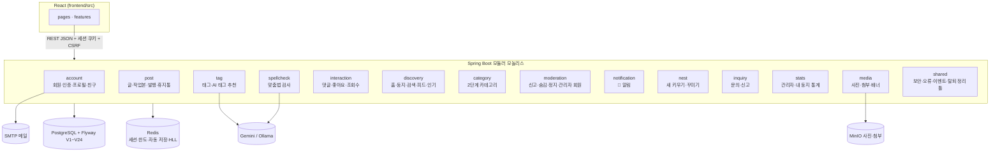

# 기능별 아키텍처 (모듈 지도)

> 2026-10-15 (2026-10-19 갱신) · **기준: BaseLOG `dev` 4c1b3de** (백엔드 `backend/src/main/java/com/team/blog/`, 프런트 `frontend/src/`).
> 전체 구조·원칙은 [02-architecture.md](./02-architecture.md), 표 정의는 [51-erd-unified.md](./51-erd-unified.md)(V1) + 그 끝의 "V1 이후 바뀐 것"(V2~V24)을 본다. 이 문서는 **기능(모듈)마다 무엇을 맡고, 어느 표를 쓰고, 어떤 API를 내고, 누구에게 기대는지**를 한곳에 모은다.

---

## 1. 한눈에 보기

모듈 규칙(헌법 II): 표는 **주인 모듈만** 쓰고, 다른 모듈은 주인의 공개 Service(`application` 패키지)나 `shared.event` 이벤트로만 닿는다. 읽기 전용 예외는 각 모듈 `package-info.java`에 적혀 있다(아래 §3 "읽기 예외").

---

## 2. 기능(모듈)별 정리

| 모듈 | 맡은 기능 (스펙) | 주인 표 | 주요 API | 기대는 모듈 |
|---|---|---|---|---|
| **account** | 가입(이메일 코드·소셜)·로그인·비밀번호·이메일 인증, 프로필, 블로그 주소·닉네임 확인, 동의(약관·AI), 친구, 정지 상태, 탈퇴·복구 (001·015·020·027) | `member` `auth_identity` `member_agreement` `friendship` `member_suspension` (`follow`는 V6 뒤 안 씀) | `/api/auth/*` (login·logout은 보안 필터, signup-code, signup, csrf, social-signup, social-providers, email-verification, password-reset), `/api/agreements/current`, `/api/me`(+profile, settings, password, agreements), `/api/me/withdraw`·`/api/me/withdrawal`·`/api/me/restore`, `/api/handles/availability`, `/api/nicknames/availability`, `/api/members/{handle}/friend`, `/api/me/friends`, `/api/me/friend-requests`, `/api/me/agreements/ai` | media(프로필·배너 사진), post |
| **post** | 글 쓰기·자동 저장·작업본·발행·수정·공개 범위(전체·친구·나만)·휴지통·완전 삭제·Markdown 미리보기, 고정 글(최대 3개), 공동 작업자(친구 최대 3명, 제목·본문만) (002·004·005·006·029·030) | `post` `post_draft` `post_collaborator` (+ `post.pinned_at`) | `POST /api/posts`, `/api/posts/{id}`(읽기·휴지통으로) (autosave, publish, working-copy, visibility, restore, permanent, pin, collaborators), `/api/me/posts`, `/api/me/trash`, `/api/markdown/preview` | account, media, tag |
| **tag** | 태그 정규화·글-태그, 태그 목록·인기 태그, AI 태그 추천 (008·013) | `tag` `post_tag` | `/api/tags`, `/api/tags/trending`, `/api/tags/suggest`, `/api/tags/{name}/posts`(+summary), `/api/members/{handle}/tags`, `/api/posts/{id}/tag-suggestions` | account, post, discovery |
| **media** | 사진 올리기(presign → 직접 업로드 → complete), 글 사진·프로필·배너, 첨부파일, 저장 용량, 정리 작업 (003·018·025) | `image` `post_image` `post_attachment` `attachment_trash` | `/api/images/presign`, `/api/images/{id}/complete`, `/api/me/storage`, `/api/posts/{id}/attachments` (+download) | account, post |
| **interaction** | 댓글·답글·비밀 댓글, 좋아요, 조회수(하루 한 번 세기) (007·009) | `comment` `post_like` `post_view_daily` | `/api/posts/{id}/comments`, `/api/comments/{id}`(+replies), `/api/posts/{id}/like`, `/api/posts/{id}/views` | account, media, post |
| **discovery** | 홈 목록·둥지(블로그) 머리말·고정 글 목록·검색(글·사람)·친구 피드·인기 글·태그 글 목록·사이트맵 (005·010·012·020·025·029) | (없음 — 읽기 전용) | `/api/posts`, `/api/posts/trending`, `/api/feed`, `/api/search/posts`, `/api/search/people`, `/api/members/{handle}`, `/api/members/{handle}/posts`(+pinned), `/`·`/@{handle}`·`/tags`·`/sitemap.xml`·`/robots.txt`(서버 렌더 메타) | account, post, tag, media, interaction, category |
| **category** | 회원별 2단계 카테고리, 글의 카테고리, 둥지 카테고리 목록 (017) | `category` (+ `post.category_id`는 post가 씀) | `/api/me/categories`(+order), `/api/posts/{id}/category`, `/api/members/{handle}/categories` | account, post |
| **moderation** | 신고 접수, 관리자 신고 처리·직접 숨김, 회원 정지·해제, 관리자 회원 목록·회원 화면 (014·026) | `report_case` `report` | `POST /api/reports`, `/api/admin/reports`(+resolution), `/api/admin/posts/{id}/hidden`, `/api/admin/comments/{id}/hidden`, `/api/admin/members`(+suspensions) | account(정지), post·interaction(숨김) |
| **notification** | 🔔 인앱 알림: 댓글·답글·좋아요(묶음)·친구 요청/수락·친구 새 글·신고 결과·숨김·문의 답변·공동 작업자 추가, 끄기 설정 (011·030) | `notification` `notification_actor` `notification_mute` | `/api/notifications`(+unread-count, read, read-all, 하나 지우기), `/api/me/notification-settings` | 이벤트로 받음 + account·post·interaction 확인 |
| **nest** | 출석·포인트·새 4단계·꾸미기 물건 사기·착용 (021) | `nest` `nest_point` `nest_item` | `/api/me/nest`(+attendance, points, items/{code}, equipped; dev/points·dev/level은 `blog.nest.dev-tools=true`일 때만), `/api/members/{handle}/nest` | account, 이벤트(글·댓글·좋아요) |
| **inquiry** | 문의·신고 보내기, 내 문의 목록, 관리자 문의 목록·답변 (023) | `inquiry` | `/api/me/inquiries`, `/api/admin/inquiries`(+{id}, answer) | account, media(사진), moderation(관리자 확인) |
| **stats** | 사이트 방문자·둥지별 방문자 세기, 관리자 통계, 내 둥지 통계 (024·028·031) | `site_visit_daily` `blog_visit_daily` | `POST /api/visits`, `POST /api/members/{handle}/visits`, `/api/admin/stats`, `/api/me/stats` | interaction, post, account(둥지 주인 찾기), moderation(관리자 확인) |
| **spellcheck** | 글쓰기 [맞춤법 검사] (022) | (없음 — 저장 안 함) | `POST /api/posts/{id}/spell-check` | post, tag(AI 공급자·한도·동의 공유) |
| **shared** | 보안(세션·CSRF·권한), 오류 형식, 도메인 이벤트, 요청 한도, 탈퇴 정리 단계 틀, Markdown 렌더러·정리, ShedLock | `shedlock` | — | (기능 모듈에 기대지 않는 게 원칙. 지금 account·post를 일부 import — §4) |

화면 쪽은 `frontend/src/features/<기능>`과 `pages/`가 같은 이름으로 짝을 이룬다. 예: `features/nest` ↔ `NestPage.tsx`, `features/inquiry` ↔ `SupportPage.tsx`·`pages/admin`, `features/manage-posts`·`features/stats` ↔ `ManageNestLayout.tsx`(내 둥지 관리).

---

## 3. 모듈 사이 이음새

### 3-1. 이벤트 (shared.event, 커밋 뒤 비동기)

| 이벤트 | 내는 곳 | 받는 곳 |
|---|---|---|
| `PostPublished` | post | nest (+20 포인트) |
| `PostWentPublic` | post | notification (친구 새 글) |
| `PostTrashed`·`PostRestored`·`PostPurged`·`PostEdited`·`PostVisibilityChanged` | post | 지금 받는 리스너 없음 (내기만 함) |
| `CommentCreated` | interaction | notification (댓글·답글), nest (포인트) |
| `CommentDeleted` | interaction | notification (알림 정리), moderation (`OrphanCaseCloser` 신고 사건 닫기) |
| `PostLiked`·`PostUnliked` | interaction | notification (좋아요 묶음), nest (받은 좋아요 포인트 — `PostLiked`만) |
| `FriendRequested`·`FriendAccepted` | account | notification |
| `ContentHidden`·`ContentUnhidden`·`ReportResolved` | moderation | notification |
| `InquiryAnswered` | inquiry | notification (→ `/support?tab=mine`) |
| `MemberWithdrawn`·`MemberRestored` | account | account 메일 (탈퇴·복구 안내) |
| `MemberSuspended` | account | 지금 받는 리스너 없음 |
| `CollaboratorAdded` | post | notification (공동 작업자로 추가됨, 끌 수 없음) |
| `FriendshipEnded` | account | post (서로의 글에서 공동 작업자 지우기 — 비동기가 아니라 친구 끊기와 같은 트랜잭션의 `@EventListener`) |

이벤트가 빠져도 원래 행동(글 발행·댓글 등)은 성공한다(헌법 V). 알림·포인트만 빠진다.

### 3-2. 탈퇴 정리 (shared `WithdrawalPurgeStep`)

유예가 끝난 회원은 모듈마다 하나씩 있는 정리 단계가 순서대로 지운다: post · category · moderation(report) · interaction(comment·like·follow) · notification · account(member·friendship·auth_identity) · media(image) · inquiry · nest. `post_collaborator`·`blog_visit_daily`는 정리 단계 없이 글·회원 행이 지워질 때 FK CASCADE로 함께 지워진다.

### 3-3. 읽기 예외 (다른 모듈 표를 읽기 전용으로 JOIN)

| 어디서 | 읽는 표 | 왜 |
|---|---|---|
| notification 목록 SQL·새 글 일괄 저장 | member·image·post·comment·friendship | 알림 한 화면에 표시 정보를 한 번에 |
| category 공개 글 수 | post·member | 카테고리별 글 수 |
| stats `StatsQueryRepository`·`MyStatsQueryRepository` | member·post·comment·post_like·post_view_daily | 합계만 셈 |
| discovery 목록·검색 | post·member·tag 등 | 읽기 전용 조회 모듈 |

---

## 4. 의존 지도 (import 수, dev 4c1b3de 기준)

`shared`는 모두가 쓰므로 뺐다. 화살표는 "왼쪽이 오른쪽의 공개 Service·DTO를 쓴다".

| 모듈 | → 기대는 모듈 (import 줄 수) |
|---|---|
| account | media 11, post 2 |
| post | media 6, tag 3, account 2 |
| tag | post 9, account 4, discovery 3 |
| media | post 3, account 1 |
| interaction | post 27, account 5, media 3 |
| discovery | post 19, account 9, media 9, tag 3, category 2, interaction 2 |
| category | post 5, account 2 |
| moderation | account 17, post 12, interaction 9 |
| notification | post 6, account 4, interaction 2, media 1 |
| nest | account 2 |
| inquiry | account 3, media 2, moderation 1 |
| stats | interaction 12, post 7, account 2, moderation 1 |
| spellcheck | tag 22, post 5, account 1 |
| shared | account 6, post 6 (원칙 "shared는 기능 모듈에 기대지 않는다"에서 벗어난 곳 — 정리 후보) |

서로 기대는 짝: account ↔ post ↔ media, tag ↔ discovery. 지금은 공개 Service끼리라 문제는 없지만, 모듈을 떼어 낼 일이 생기면 먼저 끊을 곳이다.

---

## 5. 바깥 저장소·서비스

| 대상 | 쓰는 모듈 | 무엇 |
|---|---|---|
| PostgreSQL | 전부 | 표 31개(V1 20 + V2~V24 새 표 11). Flyway V1~V24 (V15·V18·V21은 칸 추가, V16·V17·V19·V20은 환불 데이터, V23은 제약 검증만) |
| Redis | shared·account·post·interaction·tag·spellcheck·stats·inquiry 등 | 세션(Spring Session), 요청 한도 `ratelimit:*`, 가입 코드 `auth:signup*`, 자동 저장 버퍼 `autosave:*`, AI 한도·상태 `ai:*`, 방문자 HyperLogLog `stats:visit:*`·`stats:nest-visit:*` |
| MinIO (S3 API) | media | 사진(브라우저가 presigned URL로 직접 올림), 첨부(`attachments/`, 앱이 권한 확인 후 전달). 원문 04·23의 서버 경유 업로드 `PUT /api/images/{id}/content`(PROXY 모드)는 설정 값만 있고 경로는 아직 없다 |
| Gemini / Ollama | tag(013), spellcheck(022) | 배포 서버는 Gemini, 로컬은 Ollama. 키·하루 한도 공유 |
| SMTP (Gmail) | account | 가입 코드·비밀번호 재설정·탈퇴 안내 메일 |

---

## 6. 새 기능을 넣을 때

1. 새 표가 필요하면 새 모듈(또는 주인 모듈)에 두고 Flyway V 번호를 dev에서 확인해 **추가만** 한다(무중단 배포).
2. 다른 모듈 상태는 공개 Service로 묻고, 다른 모듈에 알려야 하면 `shared.event`에 이벤트를 더한다.
3. 탈퇴 때 지울 데이터가 있으면 `WithdrawalPurgeStep`을 하나 만든다.
4. 스펙은 `specs/NNN-이름/spec.md`, 이 문서 §2 표에 한 줄, §7 API 목록에 경로, 51 ERD 끝 절에 표를 더한다.

---

## 7. 전체 API 목록 (dev 4c1b3de 기준, 2026-10-19)

컨트롤러의 `@*Mapping`을 그대로 모은 목록이다(로그인·로그아웃은 Spring Security 필터). 요청·응답 모양과 오류는 각 스펙의 `contracts/openapi.yaml`·spec.md API 표를 본다. 화면 주소(`/settings`, `/admin/**` 등)는 `SpaForwardingController`가 React로 넘기므로 여기 넣지 않는다. `/`·`/@{handle}`·`/tags`·`/tags/{name}`·`/search`·`/sitemap.xml`·`/robots.txt`는 검색 엔진용 메타를 붙여 서버가 그린다(`/tags/{name}`은 2026-10-19부터 화면이 전체 태그 목록 아래에 그 태그 글을 펼친다).

- `/api/me/nest/dev/*`는 `blog.nest.dev-tools=true`(로컬)일 때만 생긴다.
- 원문 04·23과 003 스펙의 `PUT /api/images/{id}/content`(PROXY 모드)는 아직 만들지 않았다. 운영은 DIRECT(브라우저 → MinIO)만 쓴다.
- 없앤 경로: 팔로우 `/api/members/{handle}/follow`·`followers`·`following`(020), 둥지에 새 보이기 설정 `PUT /api/me/nest/show-on-blog`(021, #162).

#### account

| 방법 | 경로 | 컨트롤러 |
|---|---|---|
| `POST` | `/api/auth/login` | 보안 필터 (`AccountSecurityCustomizer`) |
| `POST` | `/api/auth/logout` | 보안 필터 (`AccountSecurityCustomizer`) |
| `GET` | `/api/agreements/current` | AgreementController |
| `GET` | `/api/auth/csrf` | AuthController |
| `POST` | `/api/auth/email-verification` | AuthController |
| `POST` | `/api/auth/email-verification/confirm` | AuthController |
| `POST` | `/api/auth/password-reset` | AuthController |
| `POST` | `/api/auth/password-reset/confirm` | AuthController |
| `POST` | `/api/auth/signup` | AuthController |
| `POST` | `/api/auth/signup-code` | AuthController |
| `POST` | `/api/auth/signup-code/verify` | AuthController |
| `GET` | `/api/auth/social-login-error` | SocialSignupController |
| `GET` | `/api/auth/social-providers` | SocialSignupController |
| `GET` | `/api/auth/social-signup` | SocialSignupController |
| `POST` | `/api/auth/social-signup` | SocialSignupController |
| `GET` | `/api/handles/availability` | AvailabilityController |
| `GET` | `/api/me` | MeController |
| `PUT` | `/api/me/agreements` | MeController |
| `DELETE` | `/api/me/agreements/ai` | AiConsentController |
| `GET` | `/api/me/agreements/ai` | AiConsentController |
| `PUT` | `/api/me/agreements/ai` | AiConsentController |
| `GET` | `/api/me/friend-requests` | FriendController |
| `GET` | `/api/me/friends` | FriendController |
| `POST` | `/api/me/password` | MeController |
| `GET` | `/api/me/profile` | MeController |
| `PATCH` | `/api/me/profile` | MeController |
| `POST` | `/api/me/restore` | WithdrawalController |
| `GET` | `/api/me/settings` | MeController |
| `PATCH` | `/api/me/settings` | MeController |
| `POST` | `/api/me/withdraw` | WithdrawalController |
| `GET` | `/api/me/withdrawal` | WithdrawalController |
| `DELETE` | `/api/members/{handle}/friend` | FriendController |
| `GET` | `/api/members/{handle}/friend` | FriendController |
| `PUT` | `/api/members/{handle}/friend` | FriendController |
| `GET` | `/api/nicknames/availability` | AvailabilityController |

#### post

| 방법 | 경로 | 컨트롤러 |
|---|---|---|
| `POST` | `/api/markdown/preview` | MarkdownPreviewController |
| `GET` | `/api/me/posts` | ManagePostController |
| `GET` | `/api/me/trash` | ManagePostController |
| `POST` | `/api/posts` | PostEditorController |
| `DELETE` | `/api/posts/{postId}` | PostTrashController |
| `GET` | `/api/posts/{postId}` | PostDetailController |
| `PUT` | `/api/posts/{postId}/autosave` | AutosaveController |
| `GET` | `/api/posts/{postId}/collaborators` | PostCollaboratorController |
| `PUT` | `/api/posts/{postId}/collaborators` | PostCollaboratorController |
| `DELETE` | `/api/posts/{postId}/permanent` | PostTrashController |
| `DELETE` | `/api/posts/{postId}/pin` | PostPinController |
| `PUT` | `/api/posts/{postId}/pin` | PostPinController |
| `POST` | `/api/posts/{postId}/publish` | PublishController |
| `POST` | `/api/posts/{postId}/restore` | PostTrashController |
| `PUT` | `/api/posts/{postId}/visibility` | PostVisibilityController |
| `DELETE` | `/api/posts/{postId}/working-copy` | PostEditorController |
| `GET` | `/api/posts/{postId}/working-copy` | PostEditorController |
| `PUT` | `/api/posts/{postId}/working-copy` | PostEditorController |

#### tag

| 방법 | 경로 | 컨트롤러 |
|---|---|---|
| `GET` | `/api/members/{handle}/tags` | BlogTagController |
| `POST` | `/api/posts/{postId}/tag-suggestions` | TagSuggestionController |
| `GET` | `/api/posts/{postId}/tag-suggestions/status` | TagSuggestionController |
| `GET` | `/api/tags` | TagController |
| `GET` | `/api/tags/suggest` | TagController |
| `GET` | `/api/tags/trending` | TagController |
| `GET` | `/api/tags/{name}/posts` | TagController |
| `GET` | `/api/tags/{name}/summary` | TagController |

#### media

| 방법 | 경로 | 컨트롤러 |
|---|---|---|
| `POST` | `/api/images/presign` | ImageUploadController |
| `POST` | `/api/images/{imageId}/complete` | ImageUploadController |
| `GET` | `/api/me/storage` | StorageUsageController |
| `GET` | `/api/posts/{postId}/attachments` | AttachmentController |
| `POST` | `/api/posts/{postId}/attachments` | AttachmentController |
| `DELETE` | `/api/posts/{postId}/attachments/{attachmentId}` | AttachmentController |
| `GET` | `/api/posts/{postId}/attachments/{attachmentId}/download` | AttachmentController |

#### interaction

| 방법 | 경로 | 컨트롤러 |
|---|---|---|
| `DELETE` | `/api/comments/{commentId}` | CommentCommandController |
| `PATCH` | `/api/comments/{commentId}` | CommentCommandController |
| `GET` | `/api/comments/{rootId}/replies` | CommentController |
| `GET` | `/api/posts/{postId}/comments` | CommentController |
| `POST` | `/api/posts/{postId}/comments` | CommentController |
| `DELETE` | `/api/posts/{postId}/like` | LikeController |
| `PUT` | `/api/posts/{postId}/like` | LikeController |
| `POST` | `/api/posts/{postId}/views` | ViewController |

#### discovery

| 방법 | 경로 | 컨트롤러 |
|---|---|---|
| `GET` | `/@{handle}` | PageShellController |
| `GET` | `/@{handle}/posts/{postId}` | PageShellController |
| `GET` | `/api/feed` | FeedController |
| `GET` | `/api/members/{handle}` | BlogController |
| `GET` | `/api/members/{handle}/posts` | BlogController |
| `GET` | `/api/members/{handle}/posts/pinned` | BlogController |
| `GET` | `/api/posts` | HomePostController |
| `GET` | `/api/posts/trending` | TrendingController |
| `GET` | `/api/search/people` | SearchController |
| `GET` | `/api/search/posts` | SearchController |
| `GET` | `/` | PageShellController |
| `GET` | `/robots.txt` | RobotsController |
| `GET` | `/search` | PageShellController |
| `GET` | `/sitemap.xml` | SitemapController |
| `GET` | `/tags` | PageShellController |
| `GET` | `/tags/{name}` | PageShellController |

#### category

| 방법 | 경로 | 컨트롤러 |
|---|---|---|
| `GET` | `/api/me/categories` | MyCategoryController |
| `POST` | `/api/me/categories` | MyCategoryController |
| `PUT` | `/api/me/categories/order` | MyCategoryController |
| `DELETE` | `/api/me/categories/{categoryId}` | MyCategoryController |
| `PATCH` | `/api/me/categories/{categoryId}` | MyCategoryController |
| `GET` | `/api/members/{handle}/categories` | BlogCategoryController |
| `GET` | `/api/posts/{postId}/category` | PostCategoryController |
| `PUT` | `/api/posts/{postId}/category` | PostCategoryController |

#### moderation

| 방법 | 경로 | 컨트롤러 |
|---|---|---|
| `DELETE` | `/api/admin/comments/{commentId}/hidden` | AdminHideController |
| `PUT` | `/api/admin/comments/{commentId}/hidden` | AdminHideController |
| `GET` | `/api/admin/members` | AdminMemberController |
| `GET` | `/api/admin/members/{handle}` | AdminMemberController |
| `POST` | `/api/admin/members/{handle}/suspensions` | AdminMemberController |
| `DELETE` | `/api/admin/members/{handle}/suspensions/current` | AdminMemberController |
| `DELETE` | `/api/admin/posts/{postId}/hidden` | AdminHideController |
| `PUT` | `/api/admin/posts/{postId}/hidden` | AdminHideController |
| `GET` | `/api/admin/reports` | AdminReportController |
| `GET` | `/api/admin/reports/{caseId}` | AdminReportController |
| `POST` | `/api/admin/reports/{caseId}/resolution` | AdminReportController |
| `POST` | `/api/reports` | ReportController |

#### notification

| 방법 | 경로 | 컨트롤러 |
|---|---|---|
| `GET` | `/api/me/notification-settings` | NotificationSettingsController |
| `PUT` | `/api/me/notification-settings` | NotificationSettingsController |
| `GET` | `/api/notifications` | NotificationController |
| `POST` | `/api/notifications/read-all` | NotificationController |
| `GET` | `/api/notifications/unread-count` | NotificationController |
| `DELETE` | `/api/notifications/{notificationId}` | NotificationController |
| `PUT` | `/api/notifications/{notificationId}/read` | NotificationController |

#### nest

| 방법 | 경로 | 컨트롤러 |
|---|---|---|
| `GET` | `/api/me/nest` | MyNestController |
| `POST` | `/api/me/nest/attendance` | MyNestController |
| `PUT` | `/api/me/nest/dev/level` | NestDevController |
| `POST` | `/api/me/nest/dev/points` | NestDevController |
| `PUT` | `/api/me/nest/equipped` | MyNestController |
| `POST` | `/api/me/nest/items/{code}` | MyNestController |
| `GET` | `/api/me/nest/points` | MyNestController |
| `GET` | `/api/members/{handle}/nest` | MemberNestController |

#### inquiry

| 방법 | 경로 | 컨트롤러 |
|---|---|---|
| `GET` | `/api/admin/inquiries` | AdminInquiryController |
| `GET` | `/api/admin/inquiries/{id}` | AdminInquiryController |
| `POST` | `/api/admin/inquiries/{id}/answer` | AdminInquiryController |
| `PUT` | `/api/admin/inquiries/{id}/answer` | AdminInquiryController |
| `GET` | `/api/me/inquiries` | MyInquiryController |
| `POST` | `/api/me/inquiries` | MyInquiryController |

#### stats

| 방법 | 경로 | 컨트롤러 |
|---|---|---|
| `GET` | `/api/admin/stats` | AdminStatsController |
| `GET` | `/api/me/stats` | MyStatsController |
| `POST` | `/api/members/{handle}/visits` | BlogVisitController |
| `POST` | `/api/visits` | VisitController |

#### spellcheck

| 방법 | 경로 | 컨트롤러 |
|---|---|---|
| `POST` | `/api/posts/{postId}/spell-check` | SpellCheckController |
