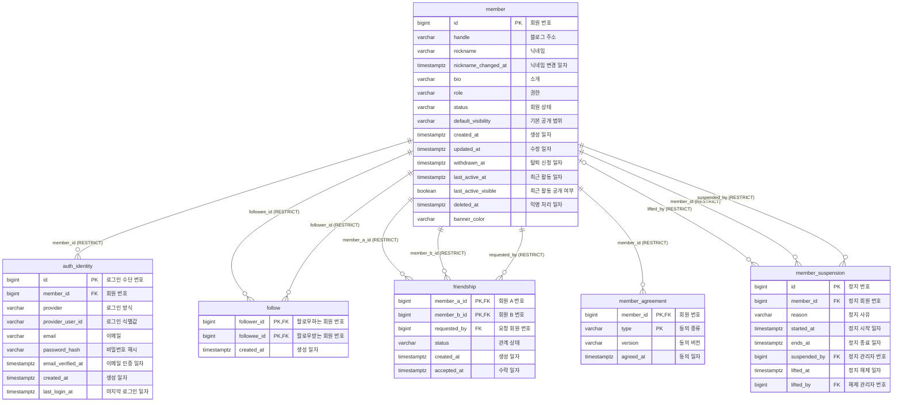
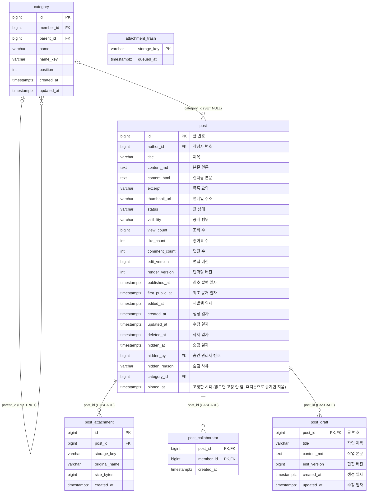
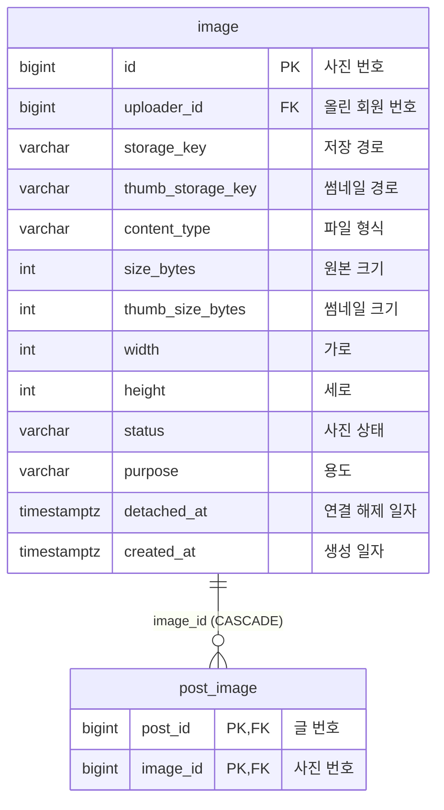
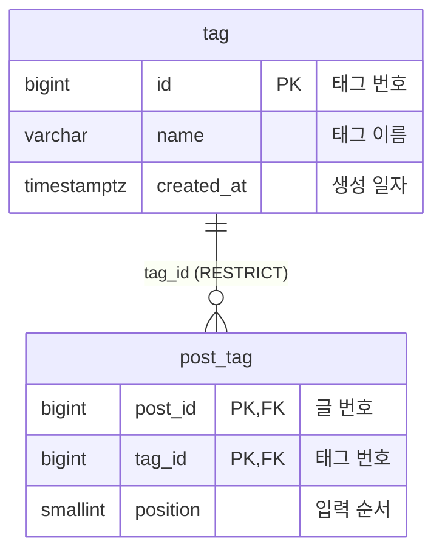
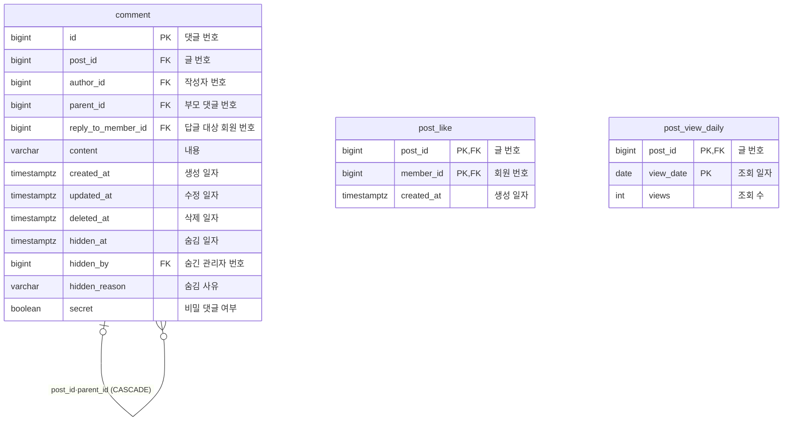
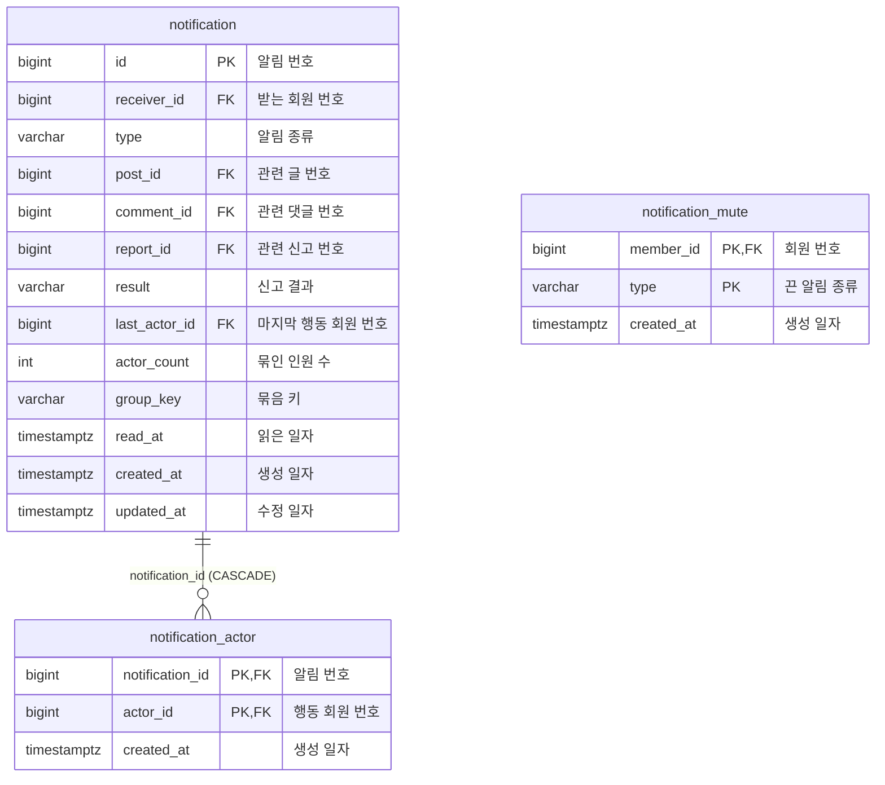
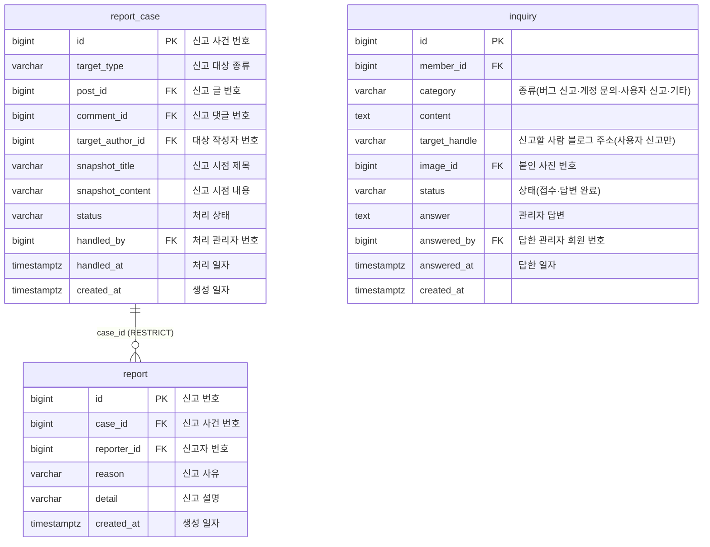
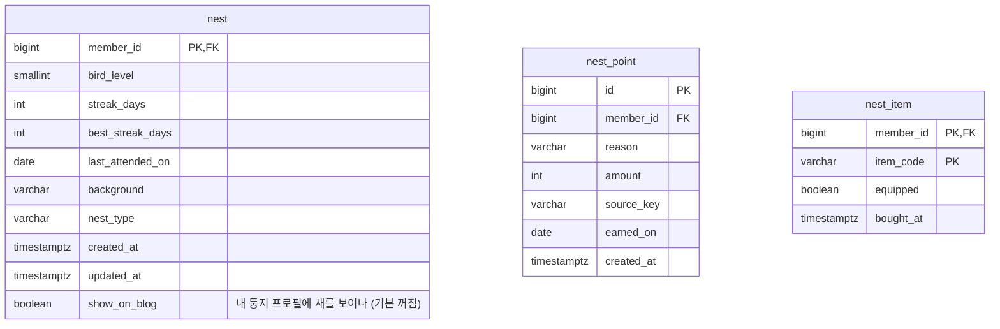
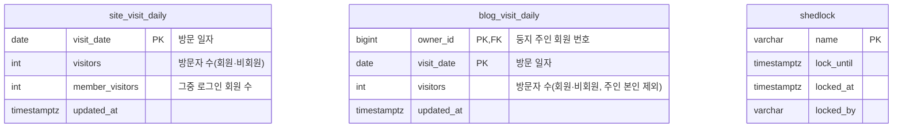

# 53. 지금 DB 구조 (ERD, Flyway V24 기준)

2026-11-25 로컬 DB에 V1~V24 마이그레이션을 모두 적용한 뒤 PostgreSQL 카탈로그(`information_schema`·`pg_constraint`·컬럼 주석)에서 자동으로 뽑았다. 손으로 고치지 말고, 새 마이그레이션이 생기면 다시 뽑는다.

- 컬럼표·제약·V2~V24 변경 이유는 [51-erd-unified.md](51-erd-unified.md)(V1 원문 + "V1 이후 바뀐 것")에 있다. 이 문서는 **한눈에 보는 그림**이다.
- `follow` 테이블은 V6에서 친구(`friendship`)로 바꾸며 행만 지우고 팀 ERD에 맞춰 남겨 두었다. 코드는 읽거나 쓰지 않는다(탈퇴 정리의 DELETE만).
- 테이블 31개, 외래 키 53개. 모듈별로 나눠 그렸고, 맨 위 그림은 테이블 사이 관계만 보인다.

## 전체 관계

```mermaid
erDiagram
  member ||--o{ auth_identity : "member_id (RESTRICT)"
  member ||--o{ blog_visit_daily : "owner_id (CASCADE)"
  member ||--o{ category : "member_id (CASCADE)"
  category |o--o{ category : "parent_id (RESTRICT)"
  member ||--o{ comment : "author_id (RESTRICT)"
  member |o--o{ comment : "hidden_by (RESTRICT)"
  comment |o--o{ comment : "post_id·parent_id (CASCADE)"
  post ||--o{ comment : "post_id (CASCADE)"
  member |o--o{ comment : "reply_to_member_id (RESTRICT)"
  member ||--o{ follow : "followee_id (RESTRICT)"
  member ||--o{ follow : "follower_id (RESTRICT)"
  member ||--o{ friendship : "member_a_id (RESTRICT)"
  member ||--o{ friendship : "member_b_id (RESTRICT)"
  member ||--o{ friendship : "requested_by (RESTRICT)"
  member ||--o{ image : "uploader_id (RESTRICT)"
  member |o--o{ inquiry : "answered_by (SET NULL)"
  image |o--o{ inquiry : "image_id (SET NULL)"
  member ||--o{ inquiry : "member_id (CASCADE)"
  member ||--o{ member_agreement : "member_id (RESTRICT)"
  member |o--o{ member_suspension : "lifted_by (RESTRICT)"
  member ||--o{ member_suspension : "member_id (RESTRICT)"
  member ||--o{ member_suspension : "suspended_by (RESTRICT)"
  member ||--o{ nest : "member_id (CASCADE)"
  member ||--o{ nest_item : "member_id (CASCADE)"
  member ||--o{ nest_point : "member_id (CASCADE)"
  comment |o--o{ notification : "comment_id (CASCADE)"
  member |o--o{ notification : "last_actor_id (RESTRICT)"
  post |o--o{ notification : "post_id (CASCADE)"
  member ||--o{ notification : "receiver_id (RESTRICT)"
  report |o--o{ notification : "report_id (SET NULL)"
  member ||--o{ notification_actor : "actor_id (RESTRICT)"
  notification ||--o{ notification_actor : "notification_id (CASCADE)"
  member ||--o{ notification_mute : "member_id (RESTRICT)"
  member ||--o{ post : "author_id (RESTRICT)"
  category |o--o{ post : "category_id (SET NULL)"
  member |o--o{ post : "hidden_by (RESTRICT)"
  post ||--o{ post_attachment : "post_id (CASCADE)"
  member ||--o{ post_collaborator : "member_id (CASCADE)"
  post ||--o{ post_collaborator : "post_id (CASCADE)"
  post ||--o{ post_draft : "post_id (CASCADE)"
  image ||--o{ post_image : "image_id (CASCADE)"
  post ||--o{ post_image : "post_id (CASCADE)"
  member ||--o{ post_like : "member_id (RESTRICT)"
  post ||--o{ post_like : "post_id (CASCADE)"
  post ||--o{ post_tag : "post_id (CASCADE)"
  tag ||--o{ post_tag : "tag_id (RESTRICT)"
  post ||--o{ post_view_daily : "post_id (CASCADE)"
  report_case ||--o{ report : "case_id (RESTRICT)"
  member ||--o{ report : "reporter_id (RESTRICT)"
  comment |o--o{ report_case : "comment_id (SET NULL)"
  member |o--o{ report_case : "handled_by (RESTRICT)"
  post |o--o{ report_case : "post_id (SET NULL)"
  member ||--o{ report_case : "target_author_id (RESTRICT)"
```

## 회원·계정 (account)

- `member` — 회원
- `auth_identity` — 로그인 수단
- `member_agreement` — 회원 동의
- `member_suspension` — 회원 정지 이력
- `friendship` — 친구 관계
- `follow` — 팔로우

## 글 (post·category)

- `post` — 글
- `post_draft` — 글 작업본
- `post_collaborator` — —
- `category` — —
- `post_attachment` — —
- `attachment_trash` — —

## 사진 (media)

- `image` — 사진
- `post_image` — 글-사진 연결

## 태그 (tag)

- `tag` — 태그
- `post_tag` — 글-태그 연결

## 반응 (interaction)

- `comment` — 댓글
- `post_like` — 글 좋아요
- `post_view_daily` — 일별 조회 수

## 알림 (notification)

- `notification` — 알림
- `notification_actor` — 알림에 묶인 사람
- `notification_mute` — 끈 알림 종류

## 신고·문의 (moderation·inquiry)

- `report` — 신고
- `report_case` — 신고 사건
- `inquiry` — 문의·신고

## 새 키우기 (nest)

- `nest` — 둥지(새 크기·연속 출석·장착한 배경과 둥지)
- `nest_point` — 둥지 포인트 기록(합이 잔액)
- `nest_item` — 산 둥지 꾸미기 물건

## 통계·인프라 (stats·shared)

- `site_visit_daily` — 일별 방문자 수
- `blog_visit_daily` — 둥지별 일별 방문자 수
- `shedlock` — 배치 실행 잠금 (ShedLock JDBC)

